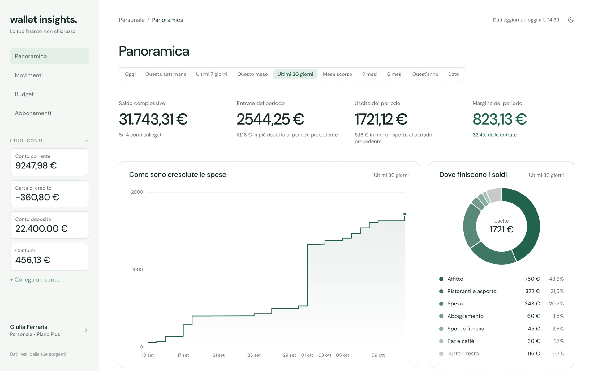
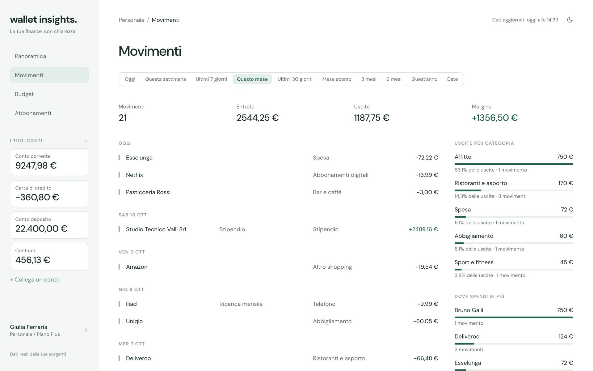
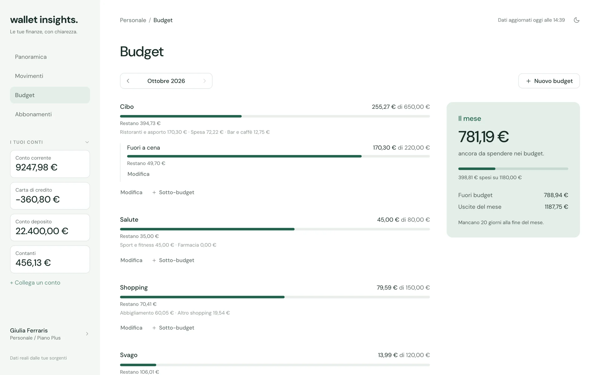
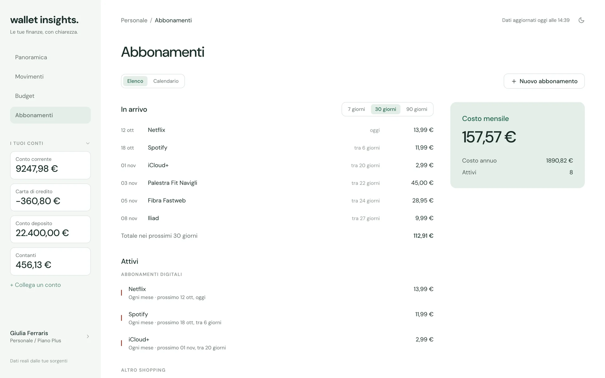

# Wallet Insights

[](https://github.com/darge98/wallet-insight/actions/workflows/frontend.yml)
[](https://github.com/darge98/wallet-insight/actions/workflows/backend.yml)
[](LICENSE)

Personal finance tracker self-hosted, pensato per **una persona sola**. Importa conti e
movimenti da [BudgetBakers Wallet](https://budgetbakers.com) e li riorganizza: categorie
proprie, budget mensili, abbonamenti e analisi di periodo, calcolate dal database. Gira
sul tuo hardware: i dati restano nel tuo PostgreSQL.

**Sito:** <https://darge98.github.io/wallet-insight/>

<picture>
  <source srcset="site/assets/panoramica-dark.webp" media="(prefers-color-scheme: dark)" />
  
</picture>

<sub>Gli screenshot mostrano dati fittizi.</sub>

## Cosa fa

- **Panoramica**: patrimonio, entrate, uscite e margine del periodo con le tendenze,
  curva cumulativa delle uscite, classifiche per categoria e controparte, budget del
  mese più consumati.
- **Movimenti**: elenco paginato con filtri per periodo, natura, conti e categorie,
  totali dell'intero filtro, modifica di descrizione, controparte e categoria.
- **Budget**: limiti mensili su gruppi di categorie, con sotto-budget, speso e residuo.
- **Abbonamenti**: addebiti ricorrenti dichiarati dall'utente, in elenco o in
  calendario, col costo mensile e annuo.
- **Categorie**: un albero a due livelli dell'utente; ogni categoria della sorgente è
  agganciata a una di Wallet Insights, e riagganciarla sposta anche i movimenti.
- **Import**: da BudgetBakers ogni giorno e a ogni avvio, incrementale. Il token
  personale è cifrato nel database con AES-256.

<table>
  <tr>
    <td width="50%">
      <picture>
        <source srcset="site/assets/movimenti-dark.webp" media="(prefers-color-scheme: dark)" />
        
      </picture>
      <p align="center"><b>Movimenti</b></p>
    </td>
    <td width="50%">
      <picture>
        <source srcset="site/assets/budget-dark.webp" media="(prefers-color-scheme: dark)" />
        
      </picture>
      <p align="center"><b>Budget</b></p>
    </td>
  </tr>
  <tr>
    <td colspan="2">
      <picture>
        <source srcset="site/assets/abbonamenti-dark.webp" media="(prefers-color-scheme: dark)" />
        
      </picture>
      <p align="center"><b>Abbonamenti</b></p>
    </td>
  </tr>
</table>

## Sorgenti dei dati

| Sorgente                                   | Stato        |
| ------------------------------------------ | ------------ |
| BudgetBakers Wallet, col token personale    | Disponibile  |
| Conti bancari via PSD2, con Enable Banking  | In sviluppo  |

## Avvio

Servono Docker e una chiave di cifratura:

```bash
git clone https://github.com/darge98/wallet-insight.git
cd wallet-insight
cp .env.example .env
openssl rand -base64 32        # da incollare in ENCRYPTION_KEY dentro .env
docker compose up -d --build
```

L'app è su <http://localhost:8081>, l'API su <http://localhost:8080> (OpenAPI su
`/swagger-ui.html`). Al primo accesso si crea il profilo e si collega BudgetBakers col
token personale generato dalle impostazioni della sua app web.

Cambiare `ENCRYPTION_KEY` rende illeggibili i token già salvati.

> L'API non ha autenticazione: è pensata per girare in locale o in una rete privata,
> non esposta su internet.

## Struttura

| Percorso                       | Cosa contiene                                                                    |
| ------------------------------ | -------------------------------------------------------------------------------- |
| [`frontend/`](frontend)        | Angular 22 + Nx: zoneless, signal, ports & adapters                              |
| [`backend/`](backend)          | Spring Boot 4 + Spring Modulith, Spring Data JDBC, Flyway, PostgreSQL 17, Java 25 |
| [`site/`](site)                | La landing pubblicata su GitHub Pages: HTML e CSS statici, senza build           |
| [`compose.yaml`](compose.yaml) | Lo stack completo: PostgreSQL, backend e frontend servito da nginx               |

I due progetti sono indipendenti e si buildano ognuno dalla propria cartella:

```bash
cd frontend && npm ci && npm run verify     # lint, test, build
cd backend && ./gradlew test                # i test col database usano Testcontainers
```

La landing si prova aprendo `site/` con un server statico qualsiasi
(`python3 -m http.server -d site`); a ogni push su `main` che la tocca, il workflow
[`site.yml`](.github/workflows/site.yml) la pubblica su GitHub Pages.

Per lo sviluppo, l'architettura e le convenzioni: [frontend/README.md](frontend/README.md)
e [backend/README.md](backend/README.md).

## Il contratto fra i due

Importi interi in centesimi, id UUIDv7, date `yyyy-MM-dd` senza fuso, enum in
kebab-case, errori come `ProblemDetail` (RFC 9457). Filtri, ordinamenti, totali e
aggregazioni li calcola PostgreSQL, mai il client.

## Licenza

[MIT](LICENSE).
